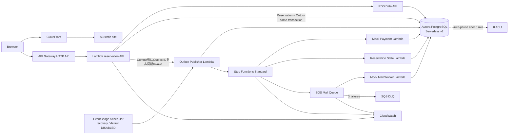

# Ticketing Lab

人気イベントの指定席予約を題材に、同時実行、冪等性、非同期処理、補償処理を段階的に学ぶためのAWSラボです。

このディレクトリは既存のCommerce Labとは独立しています。2026-11-05時点でAWSへデプロイし、画面表示、API、予約Transaction、DB反映まで確認済みです。

## 現在の構成



- Auroraは2 AZのisolated subnetに配置する。
- LambdaはVPCへ入れず、RDS Data APIを利用する。
- NAT Gateway、ALB、踏み台EC2は作らない。
- Auroraは`MinCapacity = 0`、無通信5分でauto-pauseする。
- SQLの確認はRDS Query Editorを利用する。
- 予約作成とOutbox追加を1トランザクションで行う。
- 予約Commit直後、APIがOutbox IDをPublisherへ渡し、その1行を即時配信する。
- Scheduler起動時のPublisherは、取り残された未配信Eventを最大10件回収する。
- 決済後に座席確定が失敗した場合は、補償Transactionとして返金する。
- Mailは注文結果から切り離し、失敗が3回続いたMessageはDLQへ隔離する。
- 障害ModeはPublic APIではなくSSM Parameterから変更する。
- 想定外の費用を抑えるため、APIは10 request/秒・Burst 20、Auroraは最大2 ACUに制限する。
- Sandbox AccountのQuotaでは最低10の未予約Lambda枠を残せないため、Lambda Reserved Concurrencyは設定しない。
- 回復用Outbox Schedulerは初期状態を`DISABLED`にする。DB Migrationと手動確認後だけ有効化する。

## できること

- イベントと座席の表示
- 指定席の予約
- 同じ`idempotencyKey`による再送時の二重予約防止
- 同じ席への同時予約で、一方だけが成功することの観察
- 決済成功、決済拒否、一時障害とRetryの観察
- 座席確定失敗後の補償返金の観察
- Mail失敗後のSQS RetryとDLQ隔離の観察
- `reservations`、`seats`、`outbox_events`、`payments`、`email_deliveries`の直接確認

## 今回も実装しないもの

- 実在する決済代行・Mail Serviceとの接続（現在はMock）
- RDS Proxyとの接続数比較
- Cognito、WAF、独自ドメイン
- Multi-Region、DR、CI/CD

これらは、基準構成を観察した後に要件変更として追加します。

## ローカル検証

```powershell
node --test .\tests\*.test.mjs
terraform -chdir=infra fmt -recursive -check
terraform -chdir=infra init -backend=false
terraform -chdir=infra validate
```

または次を実行します。

```powershell
.\scripts\validate.ps1
```

APIをAWSへdeployする前に、Mock Dataで画面だけを確認できます。

```powershell
node .\scripts\preview-ui.mjs
```

ブラウザで`http://127.0.0.1:4173`を開きます。座席選択と模擬予約も操作できます。

## デプロイの境界

ここにあるTerraformはAWSリソースを作成します。追加変更時も`terraform apply`は自動実行しません。

対象AWSアカウントIDは、Sourceへ保存せず環境変数で渡せます。その後、planを確認してからユーザーがapplyします。

```powershell
$env:TF_VAR_allowed_account_id = "<学習用AWSアカウントID>"
terraform -chdir=infra plan "-out=ticketing.tfplan"
terraform -chdir=infra apply .\ticketing.tfplan
```

今回のDB変更は既存Applicationを壊さない追加Migrationなので、新Lambda Codeをapplyする前に実行します。このスクリプトもDBを変更するため、自動実行しません。

```powershell
.\scripts\initialize-database.ps1 -AwsProfile sap-lab
```

初回の安全な順番は次のとおりです。

1. `outbox_schedule_state = "DISABLED"`のままplanを確認する。
2. `initialize-database.ps1`を実行し、追加Columnと2 Tableを先に作る。
3. 確認済みplanをapplyし、新Lambda CodeとWorkflowを反映する。
4. Simulation Modeを`success`にする。
5. Publisherを回復モードで1回だけ手動実行し、既存Outboxを確認する。
6. Step Functions、SQL、SQS、CloudWatchで結果を観察する。
7. 問題がなければ、取りこぼし回復を試す実験中だけSchedulerを`ENABLED`へ変更してapplyする。

```powershell
.\scripts\set-simulation-mode.ps1 -Mode success -AwsProfile sap-lab
.\scripts\invoke-outbox-publisher.ps1 -AwsProfile sap-lab
```

## 障害シミュレーション

設定できるModeは次のとおりです。変更は次に開始される処理から反映されます。

| Mode | 観察する挙動 |
| --- | --- |
| `success` | 決済、座席確定、Mailが成功する |
| `payment-transient` | 決済が2回失敗し、Step Functions Retryで成功する |
| `payment-declined` | 決済拒否となり、予約失敗・座席解放になる |
| `confirmation-failure` | 決済成功後に座席確定が失敗し、返金される |
| `refund-transient` | 返金が2回失敗してから成功する |
| `refund-failure` | 返金が失敗し続け、Executionが失敗状態になる |
| `mail-failure` | 予約は成功したまま、MailだけがRetry後にDLQへ移る |

```powershell
.\scripts\set-simulation-mode.ps1 -Mode confirmation-failure -AwsProfile sap-lab
```

実験後は必ず`success`へ戻します。

```powershell
.\scripts\set-simulation-mode.ps1 -Mode success -AwsProfile sap-lab
```

## 観察場所

- Step Functions: `sap-ticketing-lab-reservation`のExecution GraphとEvent History
- RDS Query Editor: 予約、Outbox、決済、Mail状態の対応
- SQS: `sap-ticketing-lab-mail`の利用可能Message数とDLQへの移動
- CloudWatch Dashboard: API、Lambda、Aurora、Workflow、Queueの同一時間軸比較
- Lambda Logs: Publisher、Payment、Reservation State、Mail Workerの個別処理

```sql
SELECT r.id, r.status AS reservation_status,
       p.operation_type, p.status AS payment_status, p.attempt_count,
       e.status AS email_status, e.attempt_count AS email_attempts
FROM reservations r
LEFT JOIN payments p ON p.reservation_id = r.id
LEFT JOIN email_deliveries e ON e.reservation_id = r.id
ORDER BY r.created_at DESC;
```

## 削除

学習終了後はplanを確認してから削除します。

```powershell
terraform -chdir=infra plan -destroy
terraform -chdir=infra destroy
```

削除後はRDS/Aurora、スナップショット、S3、CloudWatch Logs、Secrets Manager、SQS/DLQ、Step Functions、Scheduler、SSM Parameterに残存リソースがないか確認します。
