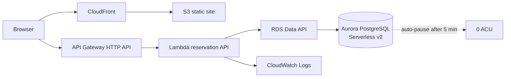

# Ticketing Lab

人気イベントの指定席予約を題材に、同時実行、冪等性、非同期処理、補償処理を段階的に学ぶためのAWSラボです。

このディレクトリは既存のCommerce Labとは独立しています。2026-11-05時点でAWSへデプロイし、画面表示、API、予約Transaction、DB反映まで確認済みです。

## 今回の最小構成



- Auroraは2 AZのisolated subnetに配置する。
- LambdaはVPCへ入れず、RDS Data APIを利用する。
- NAT Gateway、ALB、踏み台EC2は作らない。
- Auroraは`MinCapacity = 0`、無通信5分でauto-pauseする。
- SQLの確認はRDS Query Editorを利用する。
- 予約作成とOutbox追加を1トランザクションで行う。
- 想定外の費用を抑えるため、APIは10 request/秒・Burst 20、Auroraは最大2 ACUに制限する。
- Sandbox AccountのQuotaでは最低10の未予約Lambda枠を残せないため、Lambda Reserved Concurrencyは設定しない。

## できること

- イベントと座席の表示
- 指定席の予約
- 同じ`idempotencyKey`による再送時の二重予約防止
- 同じ席への同時予約で、一方だけが成功することの観察
- `reservations`、`seats`、`outbox_events`の直接確認

## 今回は実装しないもの

- Step Functionsによる決済・在庫・返金フロー
- SQSによるメール再試行とDLQ
- RDS Proxyとの接続数比較
- Cognito、WAF、独自ドメイン
- Multi-Region、DR、CI/CD

これらは、基準構成を観察した後に要件変更として追加します。

## ローカル検証

```powershell
node --test .\tests\*.test.mjs
terraform -chdir=infra fmt -recursive -check
terraform -chdir=infra init -backend=false
terraform -chdir=infra validate
```

または次を実行します。

```powershell
.\scripts\validate.ps1
```

APIをAWSへdeployする前に、Mock Dataで画面だけを確認できます。

```powershell
node .\scripts\preview-ui.mjs
```

ブラウザで`http://127.0.0.1:4173`を開きます。座席選択と模擬予約も操作できます。

## デプロイの境界

ここにあるTerraformはAWSリソースを作成します。追加変更時も`terraform apply`は自動実行しません。

対象AWSアカウントIDは、Sourceへ保存せず環境変数で渡せます。その後、planを確認してからユーザーがapplyします。

```powershell
$env:TF_VAR_allowed_account_id = "<学習用AWSアカウントID>"
terraform -chdir=infra plan "-out=ticketing.tfplan"
terraform -chdir=infra apply .\ticketing.tfplan
```

DBテーブルはapply後に次で初期化します。このスクリプトもDBを変更するため、自動実行しません。

```powershell
.\scripts\initialize-database.ps1 -AwsProfile sap-lab
```

## 削除

学習終了後はplanを確認してから削除します。

```powershell
terraform -chdir=infra plan -destroy
terraform -chdir=infra destroy
```

削除後はRDS/Aurora、スナップショット、S3、CloudWatch Logs、Secrets Managerに残存リソースがないか確認します。
